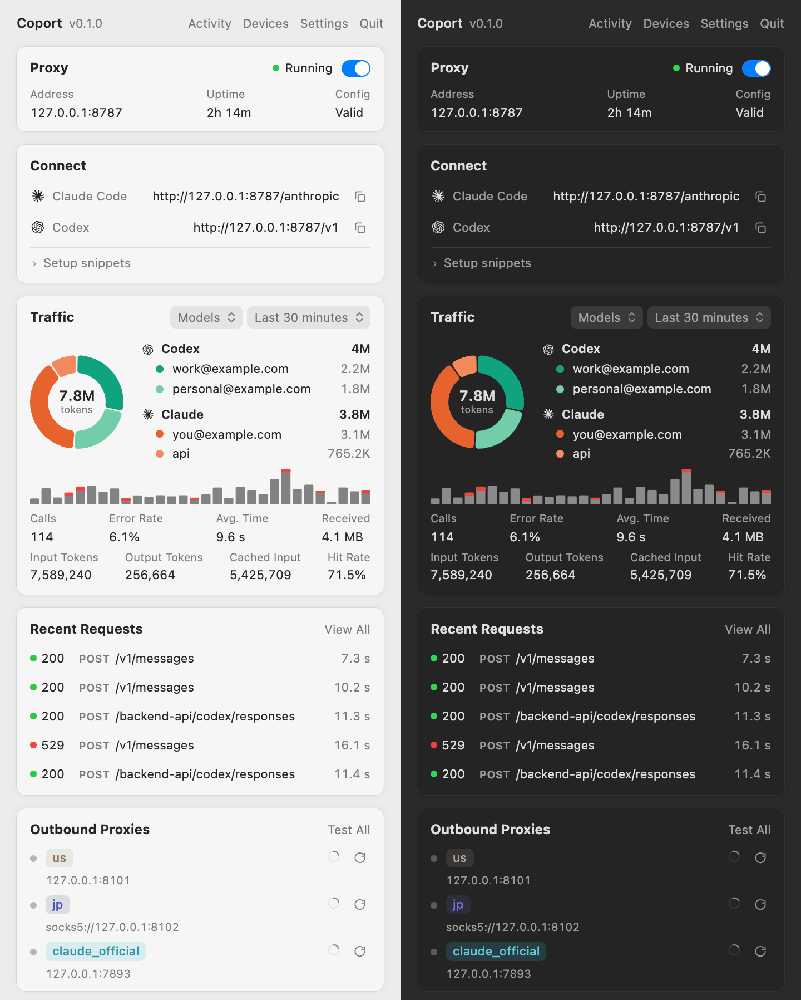
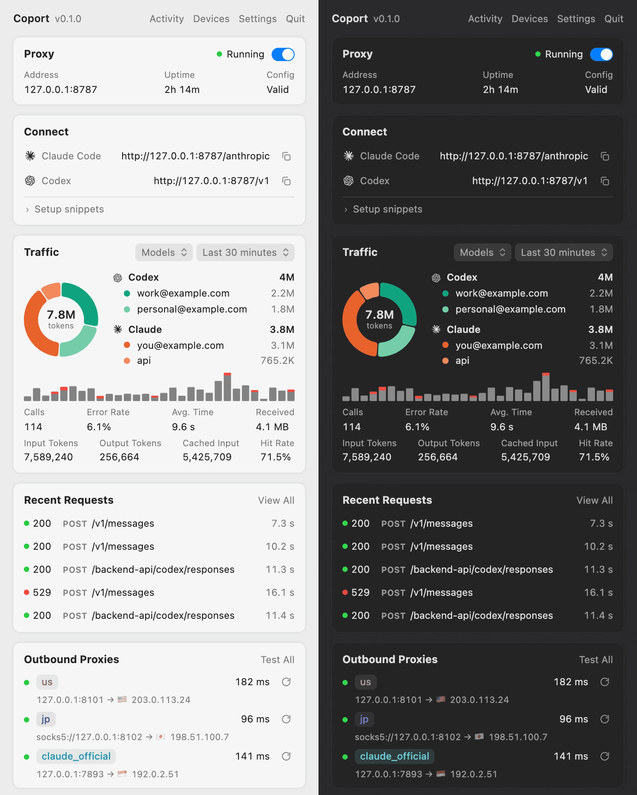

<p align="center">
  
</p>

<h1 align="center">Coport</h1>

<p align="center">
  Route Codex and Claude Code through the right outbound proxy for each account.
</p>

Coport is a cross-platform (macOS, Linux, Windows) loopback reverse proxy for Codex, Claude Code,
ChatGPT account APIs and the OpenAI documentation MCP. It matches each request's account or API Key
credential and picks the outbound proxy configured for it. HTTP/SSE and WebSocket traffic pass
through unchanged: no model mapping or protocol conversion. It ships as a CLI with a built-in
background service, and as a menu bar / tray app.

<p align="center">
  
</p>

## Features

- Per-credential routing for Codex and Claude Code: ChatGPT/Claude logins, API Keys, Codex
  providers, Claude settings files and explicit upstream URLs
- Logins read where the CLIs keep them (`auth.json`, `.credentials.json` or the OS credential
  store), refreshed per request
- HTTP, HTTPS and SOCKS5 outbound proxies with authentication and ordered, health-checked
  candidates
- Optional proxy-port (`HTTPS_PROXY`) mode that decrypts only the configured API hosts and routes
  them the same way
- Loopback TLS with a private, name-constrained CA for clients that require HTTPS
- Redacted structured logs with per-model-call status, latency and token usage
- Desktop app: proxy control, traffic charts, searchable activity log, read-only statistics from
  other devices, and request forwarding through a remote device over SSH

## Requirements

- Rust 1.85+ for the CLI; Rust 1.89+ for the desktop app
- Windows: WebView2 runtime (included with Windows 10 21H2+ and 11)
- Linux desktop app: `libwebkit2gtk-4.1-dev libayatana-appindicator3-dev librsvg2-dev libxdo-dev`

## Quick start

```sh
cargo build --locked --release
cp config.example.yaml config.yaml          # edit proxies and routes
target/release/coport --config config.yaml --check
target/release/coport --config config.yaml
```

A minimal configuration:

```yaml
listen_port: 8787
proxies:
  us: "http://127.0.0.1:7891"
codex:
  routing:
    account:
      default: us
claude:
  routing:
    account:
      "you@example.com": us
```

Point the clients at the local listener (Codex: top level of `~/.codex/config.toml`; Claude Code:
`~/.claude/settings.json`):

```toml
openai_base_url = "http://127.0.0.1:8787/v1"
chatgpt_base_url = "https://127.0.0.1:8787/backend-api"
```

```json
{ "env": { "ANTHROPIC_BASE_URL": "http://127.0.0.1:8787/anthropic" } }
```

Codex requires HTTPS for `chatgpt_base_url`; trust the CA that Coport creates in `tls/ca.pem` next
to its configuration, as described in [Connecting clients](docs/clients.md#connect-codex).

## Desktop app

The menu bar / tray panel controls the proxy from Home. **Activity** charts traffic per account and
searches the request log; **Devices** merges read-only statistics from other machines over SSH or
HTTPS.

<p align="center">
  
</p>

```sh
cargo build --locked --release -p coport-gui
target/release/coport-gui
./scripts/bundle_macos.sh                   # macOS: target/Coport.app
```

On Linux, the panel uses Copool's frosted backdrop: a blurred snapshot of the
screen taken before opening on X11, with the GNOME wallpaper as a fallback on
Wayland. The backdrop stays fixed while the panel is open; if neither source is
available, the panel keeps its opaque background.
In-panel menus blur the page behind them when WebKitGTK compositing is enabled,
otherwise they reuse the frosted background. NVIDIA systems automatically use
Copool's shared-memory rendering workaround unless renderer environment variables
were explicitly configured.

## Background service

```sh
target/release/coport service install       # launchd, systemd user service or Task Scheduler
target/release/coport service status
```

## Documentation

| Topic | Contents |
| --- | --- |
| [Configuration](docs/configuration.md) | Credential sources, routing, proxies, overrides, limits |
| [Connecting clients](docs/clients.md) | Codex, Claude Code, MCP, TLS trust, proxy-port mode, third-party APIs |
| [Desktop app](docs/desktop.md) | Panel, data locations, device statistics, remote forwarding |
| [Background service](docs/service.md) | Install, update and runtime directories |
| [Logs](docs/logs.md) | Log files, events, model-call accounting, WebSocket timeouts |
| [mihomo and Clash](docs/mihomo.md) | One local listener per outbound node |
| [Development](docs/development.md) | Checks, tests and source layout |

## Acknowledgments

Special thanks to **[Copool](https://github.com/AlickH/Copool)** and its contributors; its local
proxy implementation informed this project's design. Coport's HTTP parsing and account routing are
implemented separately and do not include Copool's account pool, rotation, quota management, model
mapping or protocol conversion. Thanks also to [mihomo](https://github.com/MetaCubeX/mihomo).
